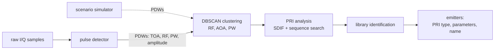
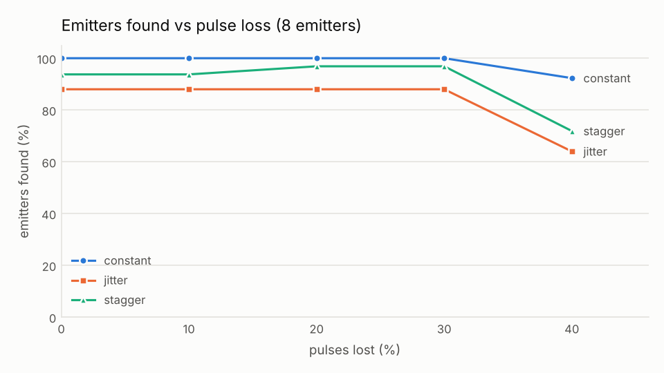
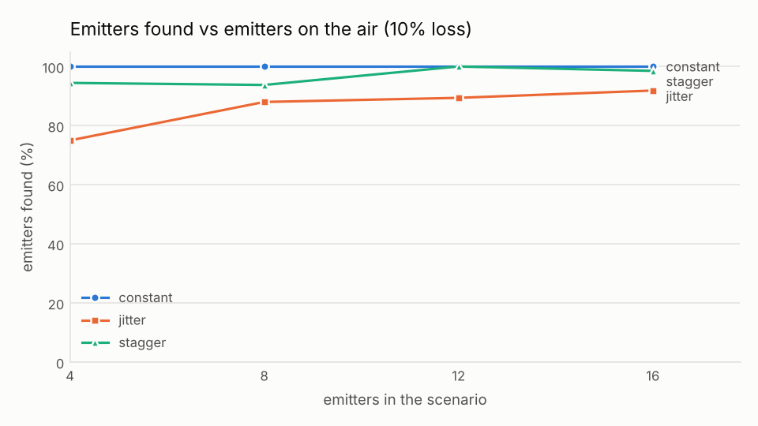
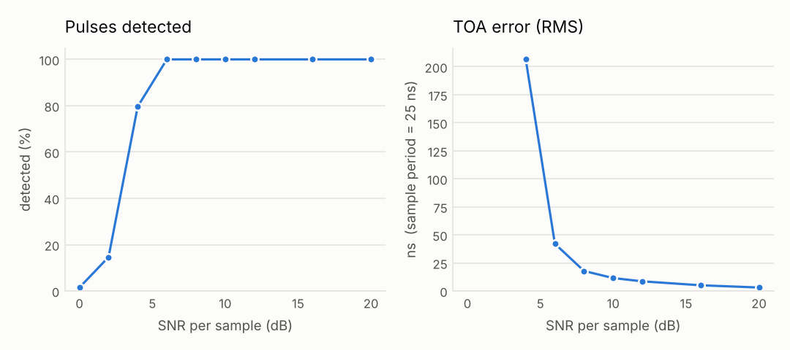

# esm-deinterleaver

A C++17 implementation of the signal processing chain inside an ESM (Electronic
Support Measures) receiver or radar warning receiver. It takes the raw I/Q samples
a receiver digitizes, finds the radar pulses, measures each one, separates radars
that are transmitting at the same time, and identifies each one against an emitter
library.

Everything runs on synthetic data from my own Python simulators, with made-up
emitters and published, open-literature algorithms. The simulators know the truth,
so every stage is scored against it.

## Highlights

| | |
|---|---|
| Pulse detection (raw I/Q, 8–25 dB SNR) | 99.98% of clean pulses found, 0 false alarms, 7.1 ns RMS time-of-arrival error at 40 MSPS |
| Deinterleaving (8 emitters, 10% pulse loss) | 120/120 constant, 68/76 jittered and 42/44 staggered PRI emitters recovered |
| Identification (25% of emitters unknown) | 206/206 library emitters named correctly, 31/31 unknowns reported as UNKNOWN, 0 wrong names |
| Throughput | about 430,000 pulses/s on 200 ms windows, 10.7x faster than real time (single thread) |
| Testing | 56 GoogleTest + 11 pytest tests, sanitizers, clang-tidy, GitHub Actions CI |

## How it works

**Pulse detection** (`src/pulse_detector.cpp`). The noise floor comes from the median
of |x|², so the pulses themselves don't raise it. A 9-sample moving average of the
power, with separate on and off thresholds (6 dB and 3 dB over the noise), decides
where a pulse starts and ends. Time of arrival and pulse width come from interpolated
50% crossings on a 3-sample average of the amplitude, which keeps the edges sharp.
Frequency comes from the angle of the summed lag-1 product, sum of x[k]·conj(x[k−1]).

**Clustering** (`src/clusterer.cpp`). DBSCAN on RF, angle of arrival and pulse width
groups pulses that look like the same emitter and labels stray pulses as noise. The
pulses are sorted by RF, the core test stops as soon as it finds enough neighbors, and
a skip list over the RF order means growing a cluster only visits pulses that can
still join it.

**PRI analysis** (`src/pri_analyzer.cpp`). Inside each cluster:

1. A sequential difference histogram (SDIF) of the gaps between pulses finds candidate
   pulse repetition intervals. The smallest peak over the threshold is tried first,
   because the tallest is often a multiple of the real PRI.
2. A sequence search follows each candidate through the pulses, tolerating dropped
   pulses, and a least-squares fit through the train gives the exact PRI.
3. Trains that share a PRI are one staggered emitter, and the stagger intervals come
   from their phases. A train whose missing pulses repeat on a schedule is rejected,
   since real pulse loss is random.
4. A second pass follows jittered PRIs, using a window that scales with the interval
   and a search tolerance sized to the measured jitter.

**Identification** (`src/emitter_library.cpp`). Each emitter is scored 0 to 1 against
every entry of `config/emitter_library.csv` (12 made-up emitters) on RF, pulse width,
PRI and PRI type. A value just outside a window gets partial credit, a weak best match
comes out as UNKNOWN, and a near-tie with the runner-up is flagged as ambiguous.

## Quick start

Needs CMake 3.20+, a C++17 compiler and Python 3. GoogleTest is used if it's
installed; otherwise CMake downloads it.

~~~bash
git clone https://github.com/alberto-hdz/esm-deinterleaver.git
cd esm-deinterleaver
python3 -m venv .venv && source .venv/bin/activate
pip install -r requirements.txt

cmake -S . -B build -DCMAKE_BUILD_TYPE=Release
cmake --build build -j
ctest --test-dir build --output-on-failure
python -m pytest -q sim/tests
~~~

Run it on a scenario drawn from the emitter library:

~~~bash
python sim/scenario.py --emitters 8 --seed 3 --library config/emitter_library.csv --out data/lib03
./build/esm_cli --pdw data/lib03/pdw.csv --library config/emitter_library.csv
~~~

~~~
loaded   2868 PDWs from data/lib03/pdw.csv in 2.0 ms
pipeline 7 clusters -> 8 emitters, 56 pulses unassigned, 9.3 ms (clustering 0.5, PRI 8.8)
library  12 entries from config/emitter_library.csv

id   clus  pulses     RF MHz    PW us     AOA  PRI                           ID (score)
T0   C0       102     4341.4     1.76   251.9  constant 1799.74              UNKNOWN (0.33)
T1   C1       786     9282.7     0.21   134.7  constant 227.33               TEST-C (1.00)
T2   C2       426     3229.4    12.37   157.6  constant 415.97               TEST-K (1.00)
T3   C2       141     3229.4    12.37   156.1  jitter 1295.0 +/-8.0%         TEST-I (1.00)
T4   C3      1020     9159.9     0.37   220.6  constant 177.54               TEST-C (1.00)
T5   C4       204     2759.7     1.97   113.1  stagger 1076 843 675          TEST-B (1.00)
T6   C5        74     9512.6     0.60   107.7  constant 2431.46              TEST-F (1.00)
T7   C6        59     1285.9    44.60   272.7  stagger 2811 2849             TEST-H (1.00)
~~~

T2 and T3 share a band, a pulse width and a bearing, so the clusterer can't split
them. The PRI analysis does: one is a constant 416 µs PRI, the other is jittered by
±8%. T0 isn't in the library, so it comes out as UNKNOWN.

Or start from raw I/Q (50 ms at 40 MSPS, a 16 MB file):

~~~bash
python sim/iq_gen.py --seed 1 --out data/iq01
./build/esm_cli --iq data/iq01/iq.c64 $(cat data/iq01/capture.txt)
~~~

### esm_cli options

| option | what it does |
|---|---|
| `--pdw <file>` | input: a PDW CSV (`toa_us,freq_mhz,pw_us,amp_db,aoa_deg[,truth_id]`) |
| `--iq <file> --fs-mhz <rate> --fc-mhz 
` | input: a raw complex64 capture; pulses are detected first |
| `--library <file>` | identify each emitter against an emitter library |
| `--no-aoa` | cluster on RF and pulse width only (automatic for `--iq`) |
| `--show-truth` | debug: which simulator emitters ended up in each result |
| `--labels <file>` | write the emitter assigned to every pulse |
| `--emitters <file>` | write one row per emitter with its parameters and library match |
| `--pdw-out <file>` | write the PDWs the detector measured from the I/Q capture |

## Results

An emitter counts as found if one output emitter holds at least 80% of its pulses at
90% purity. Every scenario has 2 pairs of emitters forced to share RF, bearing and
pulse width, so only the PRI analysis can separate them, plus 2% spurious pulses.

30 scenarios of 8 emitters each (`python sim/score.py --runs 30`, add `--drop 0.3`):

| PRI type | found, 10% pulse loss | found, 30% pulse loss |
|---|---|---|
| constant | 120 / 120 | 119 / 120 |
| jitter   | 68 / 76   | 67 / 76   |
| stagger  | 42 / 44   | 43 / 44   |

Identification, with emitters drawn from the library and 25% of them unknown
(`--library config/emitter_library.csv`):

| | count |
|---|---|
| library emitters given the right name | 206 / 206 |
| unknown emitters reported as UNKNOWN | 31 / 31 |
| wrong names | 0 |

### Raw I/Q path

20 captures of 50 ms at 40 MSPS, 4 emitters each at 8–25 dB SNR (`python sim/score_iq.py --runs 20`):

| | result |
|---|---|
| clean pulses detected | 12,990 / 12,993 (99.98%) |
| false alarms in noise-only time | 0 |
| time-of-arrival error, RMS | 7.1 ns (the sample period is 25 ns) |
| pulse width error, RMS | 10.3 ns |
| frequency error, RMS | 23.6 kHz |
| pulses overlapping another pulse (merged, not scored above) | 1,454 / 14,447 (10.1%) |
| emitters found end to end (constant / jitter / stagger) | 37/39, 18/22, 18/19 |

The plots come from `python sim/plots.py --out docs`.

## Performance

`python sim/bench.py`, single thread, Release build, on my laptop. On 200 ms windows
with 16 emitters each, the pipeline processes about **430,000 pulses/s, 10.7x faster
than real time**.

The first version of the clustering was O(n²): every pulse in a big cluster rescanned
its whole RF window, and a pulse could be queued once per neighbor. The rewrite gives
the same output on 80 test scenarios:

| capture | pulses | clustering before | clustering after |
|---|---|---|---|
| 0.2 s | 6.8k | | 0.7 ms |
| 1 s | 34k | | 5.3 ms |
| 2 s | 67k | 7.1 s | 9.3 ms |
| 10 s | 337k | ran out of memory | 125 ms |

## Repository layout

~~~
apps/esm_cli.cpp          command-line front end
include/esm/, src/        the library: pdw_io, pulse_detector, clusterer,
                          pri_analyzer, pipeline, emitter_library
tests/                    GoogleTest unit tests
config/                   the (made-up) emitter library
sim/scenario.py           PDW-level scenario simulator
sim/iq_gen.py             raw I/Q capture simulator
sim/score.py, score_iq.py Monte Carlo scoring against the simulator truth
sim/plots.py, bench.py    README plots and the benchmark
sim/tests/                pytest tests for the simulators
docs/                     result plots
~~~

## Testing

- 56 GoogleTest unit tests (PDW I/O, clustering, PRI analysis, identification, pulse
  detection) and 11 pytest tests for the simulators
- Several tests come from bugs I hit along the way: a constant emitter turning into a
  fake stagger at 30% pulse loss, weak pulses splitting in two, and a PRI shorter than
  the search tolerance looping until it ran out of memory
- AddressSanitizer and UBSan build:
  `cmake -S . -B build-asan -DCMAKE_BUILD_TYPE=Debug -DCMAKE_CXX_FLAGS="-fsanitize=address,undefined -fno-omit-frame-pointer"`
- clang-tidy clean with the checks in `.clang-tidy`: `clang-tidy -p build src/*.cpp apps/*.cpp`
- GitHub Actions builds and tests everything on every push, including a smoke test of
  all three input modes

## Known limitations

- Two jittered emitters in the same cluster usually aren't separated; the jitter pass
  needs most of the leftover gaps to agree on one PRI.
- Two constant emitters with exactly the same PRI in one cluster get merged into a
  2-level stagger. From timing alone those look identical.
- A 2-level stagger whose intervals are within a few percent of each other can be
  reported as jitter.
- The I/Q path has one antenna and no channelizer, so pulses that overlap in time come
  out as one merged pulse. About 10% of pulses overlap in the 4-emitter captures.
- PRI analysis time grows faster than linearly on very long captures (6.7 s for 337k
  pulses) because more PRI candidates clear the threshold. In 200 ms windows it isn't
  a problem.

## References

- D. J. Milojević and B. M. Popović, "Improved algorithm for the deinterleaving of
  radar pulses," *IEE Proceedings F*, vol. 139, no. 1, pp. 98–104, 1992. (SDIF)
- M. Ester, H.-P. Kriegel, J. Sander and X. Xu, "A density-based algorithm for
  discovering clusters in large spatial databases with noise," *Proc. KDD*, 1996. (DBSCAN)

## License

MIT, see [LICENSE](LICENSE).
